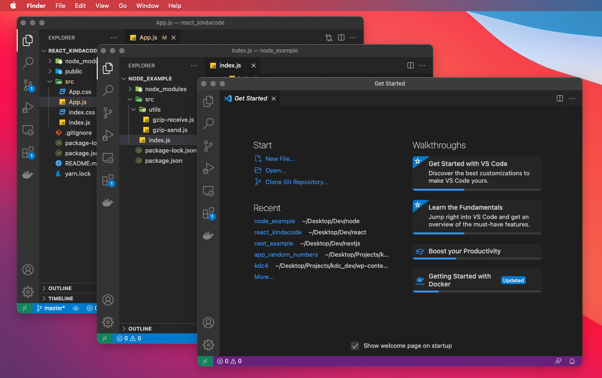

I didn't want to let it die. Most "I finally left my editor" posts pretend the author walked in open-minded and let the best tool win on merit. That's not what happened here. VSCode wasn't losing some ongoing evaluation — it had been "home" for so long that trying something else felt like relearning to type.

That's not because change bothers me generally — if anything, I like it more than most. I go through the selfh.st newsletter every week looking for something new to install. My desk setup gets rearranged often enough that "office layout" is basically a seasonal event around here. None of that churn ever touched the editor. Different machines, different operating systems, different years — VSCode was the one constant that survived all of it.

What actually got me looking in the first place was running out of desktop. Every active project meant another VSCode window, and every agent running inside that project meant another terminal tab inside that window, and at some point I had enough windows open that "window shopping" for an alternative stopped being a pun and started being a literal description of what I was doing.

*Look familiar?*

So when the current wave of agent-first dev environments showed up — tools built around running AI coding agents as the main event rather than text editing with autocomplete bolted on — I tried a handful anyway. Some of them tried to reinvent the whole experience and others did the opposite and cloned VSCode's shell closely enough that using them just felt like using a slightly worse VSCode wearing a different logo. Neither direction gave me a reason to stay.

[Orca](https://www.onorca.dev/) is the one that stuck, and it's not because it reinvented anything. It kept the exact skeleton I already knew — left column, main center window, right column — and didn't ask me to relearn where things live. The difference is what's actually running in that skeleton.

## What actually sold me

The main reason is the one from the start of this post: one screen showing every active project, every running agent, every worktree, at the same time. That's the thing multiple VSCode windows structurally cannot give you, because in VSCode a "project" is a window, and I had too many projects for that to scale. Orca's whole pitch, for me, boils down to turning that pile of windows into one overview I can actually look at.

The second thing is that the terminal gets treated like a first-class citizen instead of an afterthought. In VSCode it's a strip you resize and then forget about until it's three lines tall again, permanently squeezed below whatever tab you're actually looking at. In Orca it gets its own tab, same as a file or a diff, not a little window wedged under everything else. The chat side of that is just as unopinionated: I can run Claude Code straight from the CLI, same as I would in a plain terminal, or switch to a nicely rendered chat view of the same kind of session, and whichever one I pick, the environment around it still does its job — managing the layout, the panes, the rest of the setup — without inserting itself into how I actually talk to the model. A lot of agent-first tools treat the chat window as the product. Orca treats it as a choice.

I'm writing this sentence inside Orca right now, which isn't a clever framing device — it's just where I do this now, the same unremarkable way I used to write posts inside VSCode without thinking about it.

A few other things earned their place without needing a paragraph each: task tracking that talks to Jira and Linear directly instead of a browser tab I'd alt-tab to twenty times a day, a mobile app for checking in on a running agent without being at the desk, and remote hosts plus automations for the stuff that shouldn't need me sitting there babysitting it.

Then there's the small stuff, the kind that used to mean one plugin apiece in my old `extensions.json`: an AI usage bar, a Caffeinate-style sleep blocker, a system resource monitor, and a port-killer utility. Four separate installs before, four things that could quietly break on an update before, just there now.

And then the thing that's a bigger deal to me than it probably should be: it's free and open source. I can see what's actually running on my machine instead of taking a vendor's word for it, and switching didn't come with a new line on a credit card statement. I only recently found out it also ships a plugin repository, so a workflow-specific tool it doesn't have yet isn't a feature request you wait on — you build it and drop it in.

*Not my own setup/projects — this is one of the project's own screenshots from its [GitHub README](https://github.com/stablyai/orca), shown here to illustrate the general layout.*

## What I'm not claiming

This is one person's switch, not a benchmark. I haven't run every ADE/orchestrator on the market, and "the others felt like reinventions or cheap clones" is my reaction to the specific handful I tried, not a verdict on an entire category — someone with different habits than mine might get along fine with a tool I bounced off. I also haven't stress-tested Orca on a team project with someone else's config and conventions layered on top of mine; everything above is a single-developer, single-habit account.

What I'll actually commit to: the reason this one stuck where the others didn't has nothing to do with AI capability, which is the part most coverage of this category obsesses over. It's that it didn't make me pay a tax in muscle memory to get the new stuff. VSCode earned its spot by being the thing I already knew. Orca earned its spot by not asking me to forget that.

VSCode isn't getting reinstalled. The IDE, for me, is dead. Long live the ADE.
